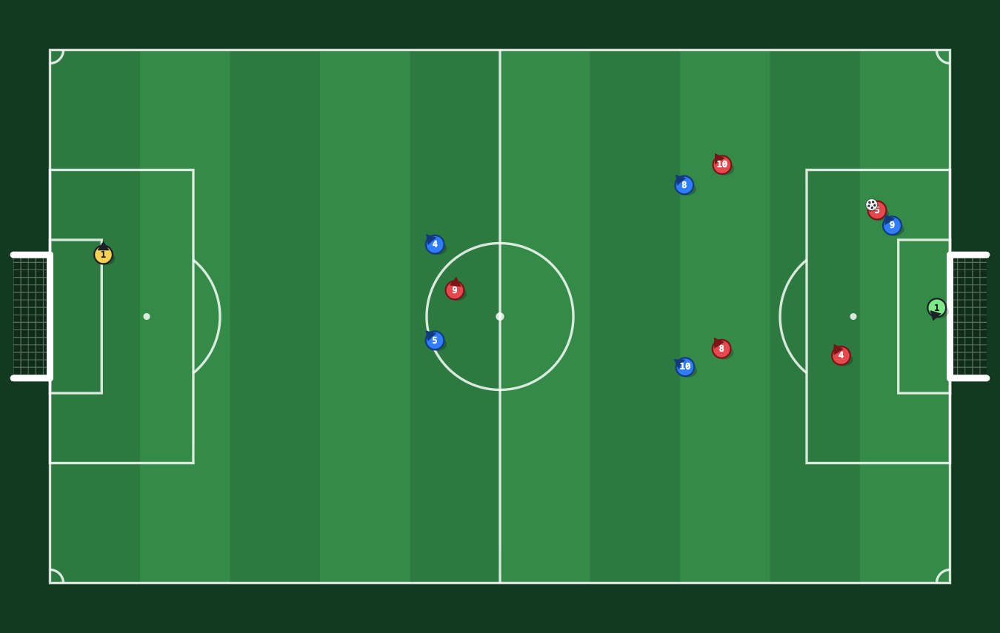

# Touchline

A fast six-a-side arcade soccer game that runs in any modern browser. No build
step, no dependencies, no downloads — just static files and a canvas.

**▶ [Play it](https://ctbot000.github.io/soccer-game/)**



## Playing

You control the highlighted player, and control follows the ball: take
possession and you get whoever is on it, lose it and you get whoever is closest.

| | Keyboard | Touch |
| --- | --- | --- |
| Run | `W` `A` `S` `D` or the arrow keys | left stick |
| Sprint | `Shift` | push the stick to its edge |
| Shoot | `Space` — hold to charge | **SHOOT** — hold to charge |
| Challenge for the ball | `Space` when you do not have it | **SHOOT** when you do not have it |
| Pass | `F` | **PASS** |
| Switch player | `F` when you do not have the ball | **PASS** when you do not have it |
| Pause / mute | `Esc` · `M` | the pause button |

Shooting has aim assist: the direction you are facing picks the corner, and the
closer you are to goal the more the shot bends onto the target. A full charge is
a little over half a second.

## The match

- **Six a side** — a keeper and five outfield players in a 2-2-1, with the shape
  sliding up and down the pitch with the ball.
- **Two halves**, each shown as 45 minutes on the clock however long you set it
  to. Ends are swapped at half time, and the other side kicks off.
- **Indoor rules**: the touchlines rebound, so the ball is never out of play and
  there are no throw-ins, corners or free kicks to interrupt the game.
- **Three difficulties**, which change only the opposition — how quickly they
  read the game, how hard they press, how accurately they finish. Your own
  team-mates always play at the same level.
- Six teams, a spectate mode if you would rather watch two CPUs play, and a
  scorer list at full time.

## How it is put together

The simulation and the presentation are kept apart, which is what makes the
match engine testable without a browser:

```
js/constants.js   pitch geometry and every tuning number
js/util.js        maths helpers and a seeded PRNG
js/world.js       teams, formation slots, kick-off restarts
js/physics.js     integration, collisions, possession
js/ai.js          shape, chasing, keeping, on-ball decisions
js/sim.js         the fixed step, the phase machine, your controls
js/render.js      canvas drawing and effects
js/audio.js       synthesised sound — no audio files
js/input.js       keyboard, mouse and touch
js/main.js        menus, the animation-frame loop, the HUD
```

Three rules the engine holds to, each of which is a bug that is invisible until
it is not:

- **The simulation has exactly one clock.** Every deadline — a decision, a
  tackle cooldown, a celebration — is stored in the simulation's own accumulated
  time, never in wall-clock time. A match driven by a test, a replay or a
  scrubbed timeline behaves identically to one driven by the browser.
- **A fixed timestep, with its baseline and accumulator reset together.** The
  physics runs at 120 Hz whatever the display does, and a long stall (a
  backgrounded tab) is clamped rather than simulated in one enormous step.
- **Effects expire on the wall clock, not on frame counts.** A hidden tab stops
  delivering animation frames, and confetti counted in frames would freeze
  on screen and stay there.

## Running it locally

Any static server will do, but the one in this repository sends
`Cache-Control: no-store`, which saves you from debugging an edit that was
served from cache:

```bash
npm run serve
```

Then open <http://localhost:8080>. Set `PORT` to use a different port.

## Tests

The match engine is pure logic, so it is tested headlessly — no browser, no DOM:

```bash
npm test
```

The suite covers the rules (kick-offs, goals, swapping ends, full time), the
invariants (nothing leaves the pitch, nobody overlaps, no NaN), the driven-loop
behaviour (identical state at 30, 60 and 144 Hz; survives a 30 second stall) and
the balance (matches finish with believable scorelines and the keepers keep).

## License

[MIT](LICENSE).
