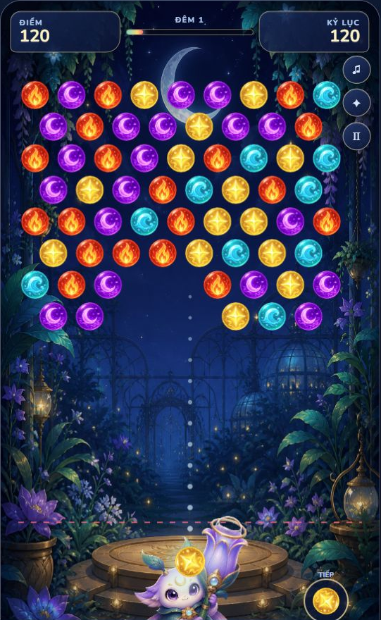

# Moonbloom Endless

> Game bắn linh cầu endless trong khu vườn ánh trăng — được xây dựng bằng HTML5 Canvas và JavaScript thuần.

[](https://github.com/DuyLuong0406/moonbloom-endless)
[](./test/core.test.js)
[](https://developer.mozilla.org/docs/Web/API/Canvas_API)
[](./LICENSE)



## Chơi ngay

Sau khi GitHub Pages được triển khai, game sẽ có tại:

**https://duyluong0406.github.io/moonbloom-endless/**

## Điểm nổi bật

- Gameplay bắn bóng endless: cụm bóng hạ liên tục và hàng mới tự sinh.
- Sáu linh cầu có màu sắc và biểu tượng riêng.
- Đường ngắm dài, hỗ trợ nảy tường và hiển thị chính xác ô bóng sẽ gắn.
- Chạm bóng `TIẾP` hoặc nhấn `R` để đổi bóng hiện tại.
- Hai linh thuật nạp bằng kỹ năng: **Trăng Nở** và **Sương Ngưng**.
- Lyra có animation thở, nhún, nghiêng theo góc ngắm, recoil và muzzle flash.
- Nhạc nền ambient nguyên bản được tổng hợp bằng Web Audio, tự fade khi pause hoặc chuyển tab và không cần tải file nhạc ngoài.
- Độ khó tăng nhẹ theo thời gian và điểm, có giới hạn tốc độ để giữ cân bằng.
- Lưu kỷ lục, combo, số lượt chơi, âm thanh và chế độ giảm chuyển động.
- Responsive cho desktop và mobile; không cần backend hoặc tài khoản.

## Điều khiển

| Thao tác | Chuột / cảm ứng | Bàn phím |
| --- | --- | --- |
| Ngắm | Kéo trên sân chơi | `←` / `→` |
| Bắn | Thả tay | `Space` |
| Đổi bóng | Chạm bóng `TIẾP` | `R` |
| Trăng Nở | Chạm nút kỹ năng | `Q` |
| Sương Ngưng | Chạm nút kỹ năng | `E` |
| Tạm dừng | Chạm nút pause | `P` / `Esc` |

Nút `♫` ở góc trên bật/tắt đồng thời nhạc nền và hiệu ứng âm thanh. Trình duyệt chỉ phát nhạc sau khi người chơi nhấn **Bắt đầu**.

## Chạy trên máy

Yêu cầu: Node.js 20 trở lên. Dự án không cần cài package.

```powershell
git clone https://github.com/DuyLuong0406/moonbloom-endless.git
cd moonbloom-endless
npm run dev
```

Mở http://127.0.0.1:4173 trong trình duyệt.

## Test tự động và build

```powershell
npm test
npm run build
npm run preview
```

Static build được tạo trong `dist/`. Mỗi lần push vào nhánh `main`, workflow GitHub Actions sẽ test, build và triển khai bản mới lên GitHub Pages.

## Hướng dẫn test game

### 1. Smoke test cơ bản

1. Chạy `npm run dev`, sau đó mở http://127.0.0.1:4173.
2. Nhấn **Bắt đầu** và bắn một bóng thẳng lên trên.
3. Xác nhận bóng bay nhanh, gắn đúng ô mà đường ngắm dự đoán và cụm bóng vẫn hạ xuống trong lúc bóng bay.
4. Nhấn `R` hoặc chạm bóng tiếp theo để đổi bóng; game không hiện thông báo gây cản trở.
5. Nhấn `P` để tạm dừng, tiếp tục và kiểm tra âm thanh/chế độ giảm chuyển động.
6. Xác nhận nhạc nền bắt đầu sau nút **Bắt đầu**, fade khi pause, tiếp tục khi resume và tắt hoàn toàn bằng nút `♫`.

### 2. Các URL QA có sẵn

Các tham số dưới đây tạo trạng thái kiểm thử lặp lại được. Nhấn **Bắt đầu** sau khi mở URL:

| Kịch bản | URL local | Điều cần xác nhận |
| --- | --- | --- |
| Thua và thử lại | http://127.0.0.1:4173/?qa=loss | Hiện thẻ **Đêm khép lại**, điểm số, nội dung đúng theme và nút **Thắp lại khu vườn** bắt đầu lượt mới sạch |
| Linh thuật đã nạp | http://127.0.0.1:4173/?qa=power | Hai linh thuật có thể kích hoạt bằng nút hoặc `Q` / `E` |
| Tốc độ theo điểm | http://127.0.0.1:4173/?qa=score | Bắt đầu ở 10.000 điểm và cụm bóng hạ nhanh hơn nhưng vẫn trong giới hạn |

### 3. Regression checklist

- Đường ngắm thẳng và nảy tường trùng với ô bóng thực tế.
- Bóng được bắn không làm dừng chuyển động hạ của cả cụm.
- Ghép từ ba bóng trở lên xóa đúng cụm; bóng mất liên kết rơi xuống.
- Hàng mới sinh liên tục và chạm vạch đỏ kết thúc lượt.
- Màn hình kết thúc không tràn chữ ở desktop/mobile; kỷ lục mới dùng nội dung riêng.
- Console trình duyệt không có `error` hoặc `warning` trong luồng bắt đầu → bắn → thua → thử lại.

Để test bản build độc lập thay vì mã nguồn, chạy `npm run build`, sau đó `npm run preview` và lặp lại checklist tại http://127.0.0.1:4174.

## Công nghệ

- HTML5 Canvas 2D
- JavaScript ES Modules
- CSS responsive
- Web Audio API
- Node.js test runner
- GitHub Actions + GitHub Pages

## Cấu trúc

```text
assets/runtime/   Asset WebP đã tối ưu
assets/fonts/     Baloo 2 và Nunito
src/core.js       Luật bàn cờ, scoring và difficulty
src/game.js       Gameplay, render, input, animation và audio
src/music.js      Bản nhạc ambient procedural và bộ lập lịch Web Audio
src/style.css     UI responsive
test/             Unit test
tools/            Build, preview và tối ưu asset
docs/             Thiết kế, QA và release notes
```

## Tác giả và bản quyền

Phát triển bởi [DuyLuong0406](https://github.com/DuyLuong0406) với sự hỗ trợ của OpenAI Codex.

- Mã nguồn được phát hành theo [MIT License](./LICENSE).
- Baloo 2 và Nunito dùng SIL Open Font License 1.1; giấy phép nằm trong `assets/fonts/`.
- Hình ảnh Moonbloom được tạo riêng cho dự án. Quy trình và prompt được ghi tại [Asset Manifest](./assets/ASSET-MANIFEST.md).

## Đóng góp

Issue và pull request đều được hoan nghênh. Khi báo lỗi, vui lòng ghi trình duyệt, thiết bị và cách tái hiện.
