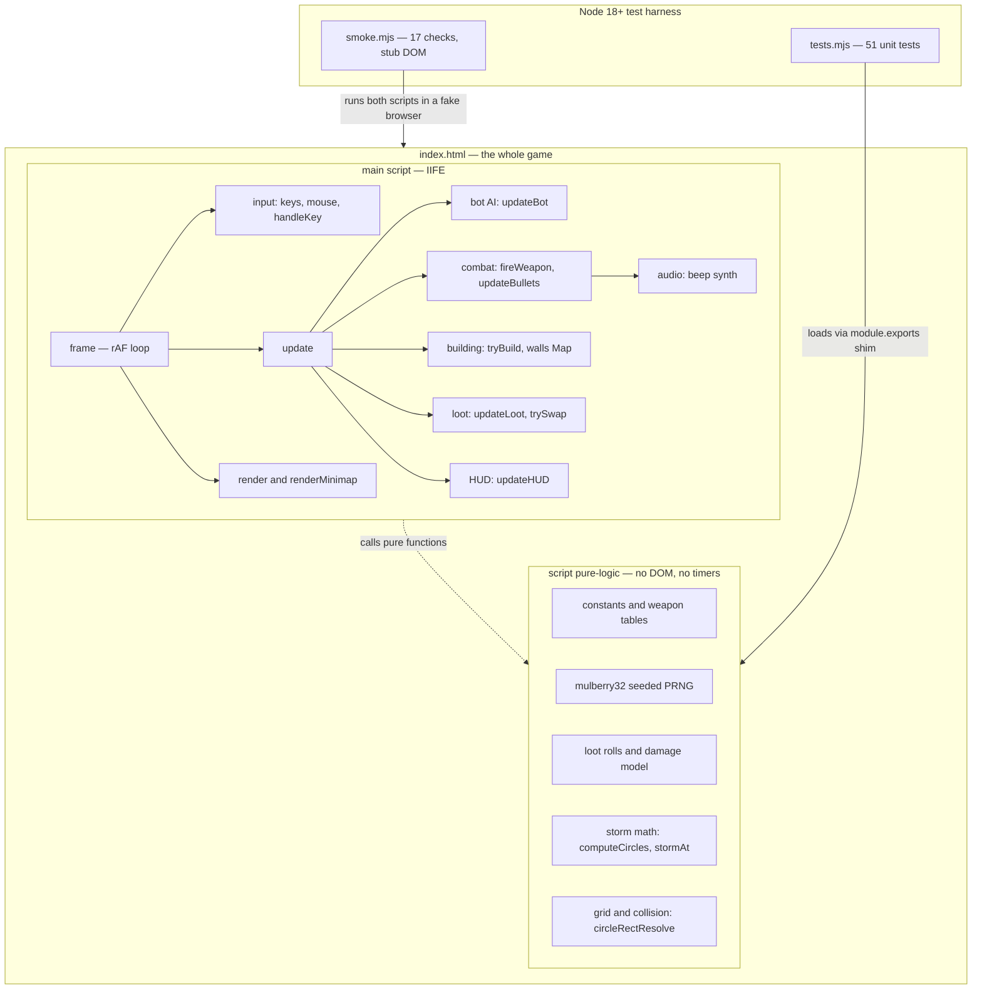

# dropzone

**Stormfall Royale** — an open-source battle royale for the browser. Vanilla JavaScript + HTML5 Canvas, zero dependencies, one file.


## About

Stormfall Royale drops 24 fighters — you and 23 bots — onto a 3200×3200 island. Scavenge weapons across five rarity tiers, harvest trees, rocks, and crates for building materials, throw up walls under fire, and outlast a storm that shrinks through six increasingly lethal phases. Last one standing wins.

The entire game lives in a single `index.html`: rendering, bot AI, physics, building, procedural terrain, and a synthesized sound engine — no frameworks, no assets, no build step. It is an original fan-made game inspired by the battle royale genre and contains **no Epic Games assets or IP**.

## 🚀 Quick start

There is no build step and nothing to `npm install`. Pick whichever suits you:

**1. Just open the file**

Download [`index.html`](index.html) and double-click it. The game runs fine from `file://`.

**2. Clone and serve**

```sh
git clone https://github.com/thecraftman/dropzone.git
cd dropzone
python3 -m http.server 8000   # or: npx serve
# open http://localhost:8000
```

**3. Any static host**

Drop `index.html` on any static host. For GitHub Pages: **Settings → Pages → Deploy from a branch → `main` → `/ (root)`**, then visit your Pages URL.

## 🎮 How to play

### Controls

| Input | Action |
|---|---|
| `W` `A` `S` `D` / arrow keys | Move |
| `Shift` (hold) | Sprint (1.32× speed) |
| Mouse | Aim |
| Left click / `Space` (hold) | Fire gun / swing pickaxe |
| `Q` / right click | Build a wall |
| `1` | Select pickaxe |
| `2` | Select gun (if you have one) |
| `E` | Swap with a gun on the ground |
| `Enter` / `Space` | Start from the menu |
| `R` | Restart — any time during play or countdown; `R` or `Enter` after a match ends |
| `P` | Pause (during play) |
| `M` | Mute / unmute |

Digit keys are read from the physical key, so holding `Shift` to sprint never turns `1` into `!`. Tabbing away releases every held key so you don't auto-run into the storm.

### A match, start to finish

- **Drop in.** After a 3-second countdown you spawn with a pickaxe, 40 ammo, 100 HP, and no shield. Two guaranteed guns land within reach of your spawn; 95 more loot items are scattered across the island.
- **Loot.** Walk over consumables to grab them — ammo (+24, cap 240), medkits (+50 HP), shield potions (+50, cap 100), materials (+30, cap 500). Your first gun is auto-grabbed; after that, press `E` near a ground gun to swap (the prompt shows whether it's an upgrade).
- **Harvest.** Swing the pickaxe at trees (12 mats/hit), rocks (15), and crates (10), plus a 15-mat bonus for destroying anything. Crates also burst into 1–2 loot drops.
- **Build.** A wall costs **10 mats**, has **150 HP**, and snaps to a 64-unit grid one cell ahead of your aim. Bullets chew through walls; your own pickaxe hits them for 55, so three swings always frees you — you can never brick yourself in.
- **Respect the storm.** The purple ring shrinks on a fixed schedule (see below) and its damage **ignores shields**. The minimap shows the current circle and the next one.
- **Win.** Shield absorbs damage first, then health. Eliminated fighters drop their gun, an ammo box, and sometimes a shield potion. Be the last of the 24 alive for **#1 Champion**.

### Rarities

Every gun rolls a rarity that multiplies its damage:

| Rarity | Color | Damage multiplier | Drop weight |
|---|---|---|---|
| Common | Gray `#9aa3ad` | 1.00× | 38 |
| Uncommon | Green `#4ecb5e` | 1.15× | 28 |
| Rare | Blue `#3fa9ff` | 1.32× | 18 |
| Epic | Purple `#c66bff` | 1.55× | 11 |
| Legendary | Orange `#ffb03a` | 1.85× | 5 |

## 🔫 The arsenal

Exact values from the `WEAPONS` table — base damage before the rarity multiplier:

| Weapon | Damage | Rate (shots/s) | Pellets | Spread (rad) | Bullet speed | Range | Ammo/shot |
|---|---:|---:|---:|---:|---:|---:|---:|
| Pickaxe | 20 | 2.4 | — | — | melee | 74 | 0 |
| Pistol | 24 | 3.4 | 1 | 0.055 | 950 | 720 | 1 |
| SMG | 13 | 10 | 1 | 0.115 | 880 | 540 | 1 |
| Shotgun | 11 | 1.2 | 6 | 0.26 | 820 | 340 | 2 |
| Assault Rifle | 30 | 5 | 1 | 0.05 | 1150 | 920 | 1 |
| Sniper Rifle | 90 | 0.75 | 1 | 0.006 | 1600 | 1500 | 2 |

The pickaxe also harvests (25 damage to obstacles per swing). Loot and swap prompts rank guns with `gunScore = damage × pellets × rate × rarityMult` — so a legendary SMG can genuinely out-score a common rifle.

## ⛈️ The storm

The real `STORM_SCHEDULE`, straight from the code. Each phase waits, then shrinks the circle to a new radius over the shrink time. The match starts at radius 1500.

| Phase | Wait (s) | Shrink (s) | New radius | Storm DPS |
|---:|---:|---:|---:|---:|
| 1 | 22 | 18 | 1050 | 1 |
| 2 | 16 | 15 | 700 | 2 |
| 3 | 13 | 12 | 460 | 4 |
| 4 | 11 | 10 | 290 | 6 |
| 5 | 9 | 9 | 170 | 9 |
| 6 | 8 | 8 | 80 | 12 |

That's 151 seconds of scheduled play; after phase 6 the storm goes into **final** mode at **18 DPS** (12 × 1.5). Two things to remember:

- Storm damage **bypasses shield entirely** (`applyStormDamage` burns health directly).
- Each new circle is generated **fully inside** the previous one (`computeCircles`), so the safe zone never jumps somewhere unreachable.

## 🏗️ Architecture

One HTML file, two script blocks with a hard boundary between them: `pure-logic` has no DOM and no timers, which is what makes the game unit-testable in Node.



Every frame: `frame(now)` clamps `dt`, `update(dt)` reads input, runs the player, 23 bots, storm damage, bullets, loot, and camera, then writes the HUD to the DOM and `render()` repaints the world and minimap. `startGame()` rebuilds the entire world (64 trees, 34 rocks, 26 crates, loot, bots, storm circles) for each match.

## 🔬 Engineering notes

- **Testability by construction.** The `pure-logic` script ends with a `module.exports` guard exporting 31 symbols (constants, PRNG, loot, damage, storm, collision), so the exact bytes the browser runs are also loaded by Node for unit tests. Everything with a side effect — DOM, canvas, audio, timers — stays in the main IIFE.
- **Deterministic worlds.** `mulberry32` is a 9-line seeded PRNG; each match reseeds it, tests rely on identical streams from identical seeds, and the grass terrain tile is painted once with a fixed seed (1234) and reused as a canvas pattern.
- **Storm circles that never misbehave.** `computeCircles` places each next circle at offset `sqrt(rng()) * (prevR - nextR)` — area-uniform sampling with nesting guaranteed by construction, no rejection loop. `stormAt` is a pure function of elapsed time, so storm state is trivially testable.
- **Collision without a physics engine.** Walls live in a `Map` keyed by grid cell (`cellKey`), giving O(1) bullet-vs-wall checks and 3×3-neighborhood lookups in `moveEntity`. `circleRectResolve` pushes circles out along the contact normal, with a nearest-face escape when the center is inside the rect. Bullets step in **2 substeps per frame** (`updateBullets`), so even a 1600 px/s sniper round at the 50 ms dt cap moves 40 px per substep — under the 64 px wall cell, no tunneling.
- **A whole browser in 207 lines.** `smoke.mjs` fakes the canvas 2D context with a single JS `Proxy`, stubs just enough DOM for the HUD and killfeed, drives `requestAnimationFrame` manually at 50 ms per frame, and plays up to 400 seconds of a real match — bots fighting, storm shrinking, end screen, restart.
- **Sound with no sound files.** `beep(freq, dur, type, vol, slideTo)` spawns one oscillator + gain node per cue with an exponential pitch slide and decay; all 12 named cues (per-gun gunshots, the elimination sting, a four-note win arpeggio) are built from it via the Web Audio API.
- **Stable simulation.** `frame` clamps `dt` to 50 ms so a backgrounded tab never teleports the sim, and a `blur` handler releases all held input.

## ✅ Testing

Node 18+ is needed **only for the tests** — the game itself runs in any modern browser.

```sh
node tests.mjs   # 51 unit tests on the pure-logic block
                 # + node --check syntax gate on every script block
node smoke.mjs   # 17 checks: boots the full game under a stub DOM
                 # and simulates an entire match end-to-end
```

`tests.mjs` covers the PRNG, loot tables, the shield-first damage model, storm-bypasses-shield, pickup caps, circle nesting across 30 seeds, `stormAt` phase math, and collision push-out invariants. `smoke.mjs` verifies boot, the core keybindings (move, fire, build, swap, slots, mute, pause), blur key-release handling, bot eliminations, the end screen, and restart.

## 📁 Project structure

```
dropzone/
├── index.html   # the entire game: CSS, HUD, pure-logic script, main script
├── tests.mjs    # 51 unit tests + syntax check of every script block
├── smoke.mjs    # 17-check smoke harness: full simulated match, stub DOM
├── LICENSE      # MIT
└── README.md    # this file
```

## 🛠️ Built with

- **[Claude Fable 5](https://www.anthropic.com)** — Anthropic's frontier model, which wrote the game, the tests, and this README
- **Vanilla JavaScript** (ES2020+) — no frameworks, no transpiler
- **HTML5 Canvas 2D** — all rendering, including procedural terrain
- **Web Audio API** — fully synthesized sound, zero audio assets
- **CSS** — HUD and overlays

Zero runtime dependencies. Zero build tools.

## 🤝 Contributing

Issues and PRs welcome. Keep the constraints that make this project fun: a single self-contained `index.html`, no dependencies, and game logic that stays pure and tested. Run `node tests.mjs && node smoke.mjs` before submitting — both must pass clean.

## 📄 License

MIT — see [LICENSE](LICENSE).
